> L’été dernier, je suis rentré en Chine pour un peu plus de trois mois de vacances, et j’en ai profité pour retourner en voiture avec ma mère au berceau de la famille, au Hebei. En chemin, il y a eu des moments pleins de rires, mais aussi des remous d’émotion qui m’ont arraché des larmes. Si ma mémoire était une toile d’un blanc immaculé, ces instants seraient les larges touches d’encre et de couleur qu’on y aurait jetées, certaines éclatantes, d’autres plus sombres ; et quand je les savoure de nouveau aujourd’hui, l’arrière-goût reste un mélange de doux et d’amer. Ayant trouvé par hasard un peu de temps libre ces jours-ci, j’ai voulu coucher toutes ces impressions par écrit, pour que, même si un jour je deviens gâteux, ces mots me permettent encore de revenir en arrière et de sentir l’air légèrement humide de cet été-là.

## Xuzhou, pluies des prunes
Il y a environ 900 kilomètres de route entre Nanjing et Dingzhou, dans la province du Hebei ; en roulant vite, on peut les faire en une journée. Ce n’était d’ailleurs pas la première fois que nous rentrions au pays en voiture. Autrefois, mes parents se relayaient au volant ; désormais, une part de ce fardeau repose aussi sur mes épaules. L’itinéraire allait grosso modo de Nanjing à Xuzhou, puis de Xuzhou à Dingzhou. Comme mon père devait justement partir en déplacement professionnel à Xuzhou, nous sommes d’abord partis tous les trois ensemble ; une fois à Xuzhou, ma mère et moi devions nous relayer au volant jusqu’au Hebei.

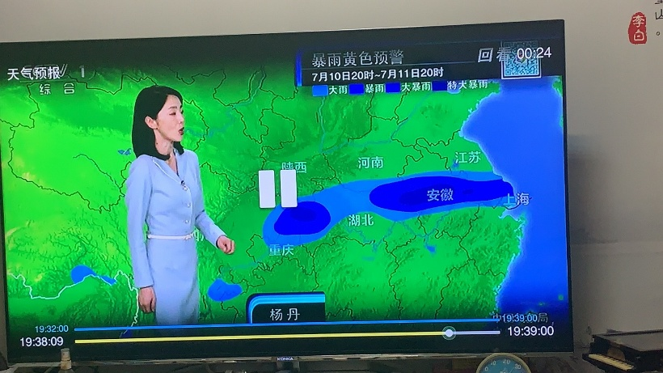

La mi-juillet marquait la queue de la saison des pluies des prunes : la bande pluvieuse, sur le flanc nord de l’anticyclone subtropical, était en train de sauter du bassin du Yangtsé vers celui de la Huai. En consultant la météo avant de partir, nous avions vu qu’en arrivant à Xuzhou, nous tomberions malencontreusement en plein cœur de la bande de pluie principale, qui venait tout juste de quitter Nanjing. Arrivés à Xuzhou, nous avons d’abord fait un crochet pour jeter un œil aux tombeaux Han de Guishan ; la pluie forcissait déjà peu à peu. Quand nous avons battu en retraite à la hâte pour reprendre la voie rapide surélevée qui fait le tour de Xuzhou, en direction de notre hôtel, c’était justement moi qui conduisais, et l’averse a atteint son paroxysme à ce moment précis. Très vite, un gros bouchon s’est formé devant nous. Au début, nous pensions que c’étaient simplement les voitures qui roulaient au pas sous l’orage ; ce n’est qu’après avoir avancé un peu que nous avons compris que le ciel nous était tombé sur la tête : un peu plus loin, la voie surélevée allait plonger dans un tunnel pour passer sous un pont ferroviaire, et le tunnel sous le pont était déjà complètement inondé ! Qui aurait cru que ces histoires de passages souterrains noyés que je lisais autrefois dans le journal nous arriveraient pour de vrai ? Mais nous n’avions plus le choix : la voie surélevée était fermée, sans aucune sortie, et nous ne pouvions que nous laisser emporter par le flot des voitures.

Arrivés sous le pont, nous avons poussé un soupir de soulagement : seule la moitié environ de la chaussée était submergée par une eau jaunâtre, et une voie restait tant bien que mal praticable ; tout le monde faisait la queue pour l’emprunter. Après avoir franchi le passage souterrain à notre tour, nous avons vite découvert d’où venait toute cette eau. À la sortie reprenait une autre portion de voie surélevée, bâtie à flanc de colline, et la crue boueuse qui dévalait la pente, ne trouvant aucune issue contre cette chaussée collée au relief, roulait en torrent le long de la voie extérieure avant de s’engouffrer dans le passage souterrain. Comme nous roulions plutôt sur la droite, nous allions devoir traverser la partie de la route recouverte par les eaux. C’était la première fois que je me retrouvais face à une inondation en ville, et j’avais une peur bleue que l’eau noie carrément le moteur ; j’étais tendu à l’extrême. En traversant le tronçon inondé, j’entendais l’eau gifler les portières et je sentais le courant pousser la voiture de côté ; le volant semblait moins facile à tenir qu’avant. Heureusement, nous avons fini par franchir ce passage avec plus de peur que de mal. Plus tard, près de notre destination, nous sommes de nouveau tombés sur de l’eau stagnante, à un endroit où il fallait tourner à droite ; force nous a été de renoncer à tourner, de continuer tout droit, de faire demi-tour, puis de tourner à gauche.

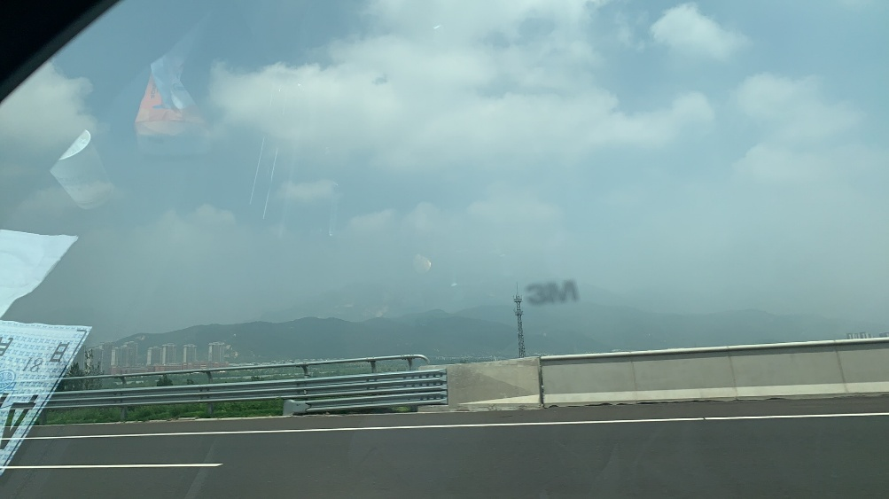

Le lendemain matin, après la pluie, le ciel s’était dégagé, et ma mère et moi avons pris la route de bonne heure. Si nous rentrions au pays cette fois-ci, c’était surtout pour voir ma grand-mère. En arrivant à Dingzhou, je ne reconnaissais presque plus rien. De part et d’autre de l’artère principale avait surgi un quartier d’affaires que je n’aurais jamais imaginé ici ; entre les cinémas et les enseignes de restaurants en tout genre, on ne savait plus où donner de la tête. Ça avait un petit air du Deji Plaza, le centre commercial chic de Nanjing. Quand j’étais petit, il n’y avait au bord des routes que des tricycles de fortune qui vendaient des en-cas et des brochettes d’aubépines caramélisées. Si j’étais un enfant qui grandissait à Dingzhou, mon enfance serait sûrement très heureuse, elle aussi, non ? me disais-je.

## Arrivée à Dingzhou

Quand nous sommes arrivés à la maison, ma grand-mère était assise sur le canapé devant la télévision, tout sourire. Ses cheveux argentés semblaient encore plus clairsemés qu’avant, et elle avait beaucoup maigri, peut-être à cause de son diabète. En m’asseyant à côté d’elle, je me suis demandé, un peu anxieux : pendant que j’étais au Canada, elle avait fait un petit AVC et passé quelques jours à l’hôpital ; où en étaient ses facultés cognitives à présent ? Dès qu’elle a ouvert la bouche, j’ai été soulagé : ouf, elle me reconnaissait encore. Seulement, par rapport à il y a trois ans, elle parlait plus lentement, et sa voix tremblait un peu. Elle entendait aussi plus mal ; je devais presque crier pour lui parler. Je ne sais pas pourquoi, mais ma grand-mère a toujours refusé catégoriquement qu’on lui fasse porter un appareil auditif. En pensant à sa vie sans appareil, j’ai eu un pincement au cœur. Comme ses jambes ne la portent presque plus, elle ne sort pour ainsi dire jamais, et ses contacts avec le monde extérieur sont quasi inexistants. Dans ces conditions, n’y voyant plus clair et n’entendant plus bien, elle doit avoir du mal à suivre ne serait-ce que la télé ou le journal. Je n’ai pas pu m’empêcher de me demander : quel plaisir peut-on trouver à une vie aussi close, aussi figée ? Chaque jour les mêmes trois repas, le même repos… on n’exagère guère en parlant d’emprisonnement, non ? Et moi, quand je serai vieux, vivrai-je aussi comme ça ? Je n’osais pas y penser davantage.

Nous avons d’abord pris environ deux jours pour nous reposer à Dingzhou. Mon oncle aîné m’a emmené faire un tour au musée d’histoire qui venait d’ouvrir, puis nous sommes retournés gravir la pagode du temple Kaiyuan de Dingzhou. Petite page de pub : la pagode du temple Kaiyuan est la plus haute pagode en brique encore debout en Chine ! La dernière fois que je l’avais escaladée, je devais être tout petit ; je n’en gardais aucun souvenir. Comme mon oncle aîné avait lui aussi fait une hémorragie cérébrale et marchait avec peine, il a préféré m’attendre en bas et m’a laissé monter seul. Chaque marche de l’escalier faisait bien un demi-mètre de haut, et pour se hisser, il fallait s’agripper aux chaînes de fer qui couraient de chaque côté de l’étroit passage. Arrivé au dernier étage, je me suis mis à explorer l’intérieur. Sur les murs, de nombreuses inscriptions à l’encre laissées par les gens d’autrefois étaient protégées sous verre. Certaines étaient des poèmes de lettrés ; d’autres n’étaient qu’une petite ligne dans le genre de nos « Untel est passé par ici », simplement tournée dans une langue plus fleurie. Je n’ai pas pu m’empêcher d’imaginer un lettré de jadis, en tunique de grosse toile et chaussures de tissu, escaladant la pagode à quatre pattes, hors d’haleine. Toute la sérénité imperturbable propre aux lettrés avait bien dû s’évaporer dans cette posture peu glorieuse ! (Cela dit, que Wang Anshi ait gravi une pagode et en soit ressorti avec un poème comme « En montant au pic Feilai », celui où il ne craint pas les nuages qui voilent la vue puisqu’il se tient à l’étage le plus haut, il faut reconnaître que le bonhomme avait du caractère.) Haha, mais au fond, les lettrés étaient des gens ordinaires, eux aussi, qui griffonnaient leur « est passé par ici » comme tout le monde. Je me suis alors demandé : et si les prétendus « comportements incivils » des touristes d’aujourd’hui, ces « Untel est passé par ici » et ces « xxx love xxx » tracés de travers, devenaient eux aussi un jour des reliques protégées sous verre ? Ce serait d’un comique ! Vu sous cet angle, la différence entre civil et incivil n’existe tout simplement pas.

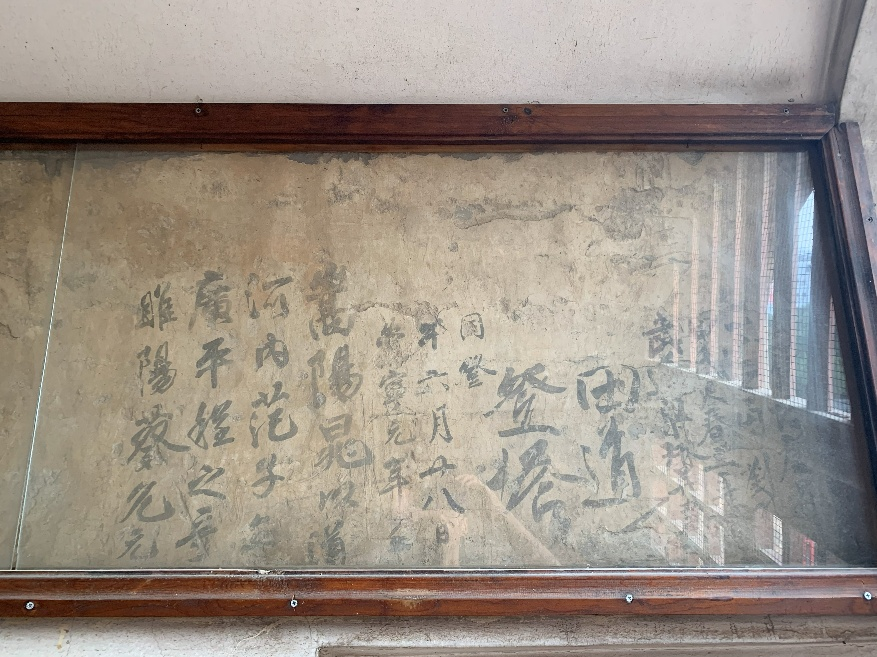

## Escapade à Zhangbei
Pendant ces jours de repos, ma mère m’a confié son projet : emmener en voiture ma grand-mère, mon oncle aîné et mon plus jeune oncle jusqu’à la « Route céleste des prairies », un site star des réseaux sociaux près de Zhangbei (un district au nord de Zhangjiakou), et elle m’a demandé mon avis. Un peu inquiet, je me suis demandé tout haut si la santé de ma grand-mère supporterait les cahots du voyage. Ma mère a été franche : si on n’y allait pas maintenant, on n’en aurait peut-être plus jamais l’occasion. Elle m’a ensuite expliqué que, justement parce que c’était risqué, elle n’en avait parlé à personne, surtout pas à mon père, qui s’y opposerait à coup sûr. C’est peut-être le dernier voyage de sa vie, pensais-je à propos de ma grand-mère. De tous ses frères et sœurs, ma mère est celle qui vit le plus loin du pays natal ; elle voulait saisir cette précieuse occasion de remplir son devoir de fille. Comment aurais-je pu refuser ? J’ai donc accepté sur-le-champ de faire la route jusqu’à Zhangjiakou en me relayant avec elle au volant. Contre toute attente, quand ma mère a dévoilé le projet à tout le monde, ma grand-mère s’y est vivement opposée. Nous avons essayé de la convaincre un moment, en vain. Ma mère m’a glissé en aparté que ma grand-mère avait sans doute un peu peur de mourir loin de chez elle. C’est là que j’ai compris que, même si elle avait un caractère bien trempé et n’avait rien d’une femme de l’ancienne société, superstitieuse et arriérée, elle ne pouvait échapper tout à fait à l’influence de la culture paysanne toute simple, vieille de plusieurs millénaires. À notre grande joie, au bout d’un moment, elle a fini par accepter.

### Les monts Taihang
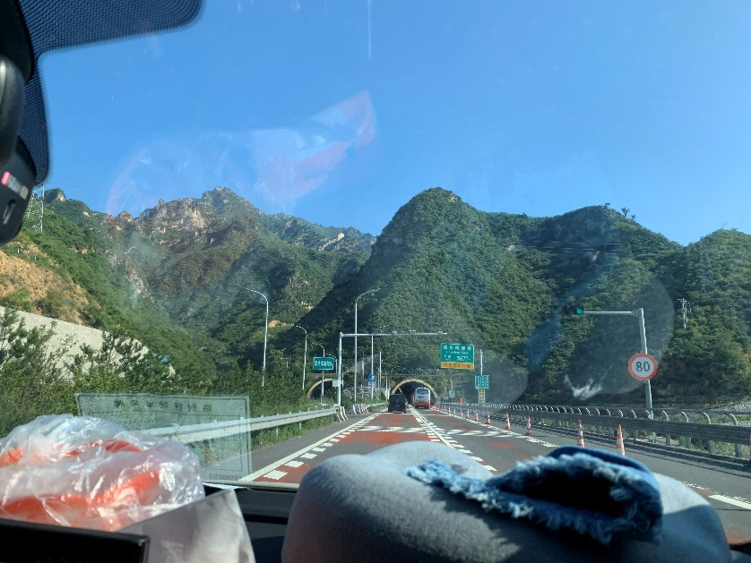

Le lendemain, vers 6 heures du matin, notre petite troupe s’est mise en route pour devancer la chaleur. Ma mère et moi nous sommes relayés au volant pendant tout le trajet, tous deux à l’avant, tandis que ma grand-mère, mon plus jeune oncle et mon oncle aîné étaient assis à l’arrière. Avant de partir, je pensais que nous prendrions l’autoroute Pékin–Shijiazhuang jusqu’à Pékin avant de repartir vers Zhangjiakou, mais l’itinéraire tracé par le GPS passait par l’ouest. Nous allions d’abord filer vers l’ouest par Quyang, puis remonter vers le nord en traversant les monts Taihang par Laiyuan et Yuxian, avant de suivre les vallées de la Sanggan jusqu’à Zhangjiakou. Bien sûr, cet itinéraire, je l’ai reconstitué après coup sur la carte ; sur le moment, je ne m’étais pas rendu compte que nous allions franchir les Taihang. Au début du voyage, ma grand-mère était plutôt en forme et reconnaissait encore où nous étions. Vers Quyang, des collines de quelques dizaines de mètres ont commencé à apparaître de part et d’autre de l’autoroute. Mon oncle aîné a alors fait remarquer qu’une fois à Laiyuan, ce ne serait plus que des montagnes. Très vite, j’ai compris que nous étions entrés dans la montagne. Personne ne connaissait plus ces routes. Les longs tunnels se succédaient, et la vitesse maximale était descendue à 80–90 km/h. Cela m’a rappelé le jour où, tout petit, nous étions allés en voiture de Nanjing à Xi’an : dans les monts Qinling, c’était pareil. À peine sorti d’un tunnel d’une bonne dizaine de kilomètres, avant même d’avoir entrevu le ciel, on s’engouffrait dans le suivant, une bonne dizaine de kilomètres encore. Ni ciel ni soleil, ou presque.

Au moment même où je commençais à m’habituer à la lumière blafarde des tunnels, l’autoroute a soudain jailli d’entre les montagnes pour déboucher sur une large vallée, et en un instant, le tunnel s’est changé en un viaduc haut d’une centaine de mètres ! Encore sous le choc, j’ai jeté un coup d’œil sur ma droite et j’ai vu un spectacle plus grandiose encore : au bord de la vallée toute plate, sans crier gare, se dressait tout un massif ! Les montagnes s’élevaient d’un seul jet, leurs falaises abruptes presque à angle droit avec le sol, comme une rangée de dents acérées sorties des gencives de la terre, droites et majestueuses, à vous inspirer une crainte révérencielle. Vu de loin, notre viaduc de cent mètres ne devait être à cet instant qu’un fil dentaire d’une finesse négligeable, enroulé près de la racine de ces dents. Un souffle si sauvage, si immense… serait-ce donc ça, les monts Taihang ? me suis-je dit, le cœur battant. Ce devait être la première fois que je levais les yeux vers le Taihang. À cet instant, un vers de Li Bai m’est soudain revenu : « Je voudrais gravir le Taihang, mais la neige couvre les monts. » Au pied du Taihang, même l’Immortel de la poésie aurait eu du mal à ne pas « tirer l’épée, regarder alentour, le cœur égaré ».

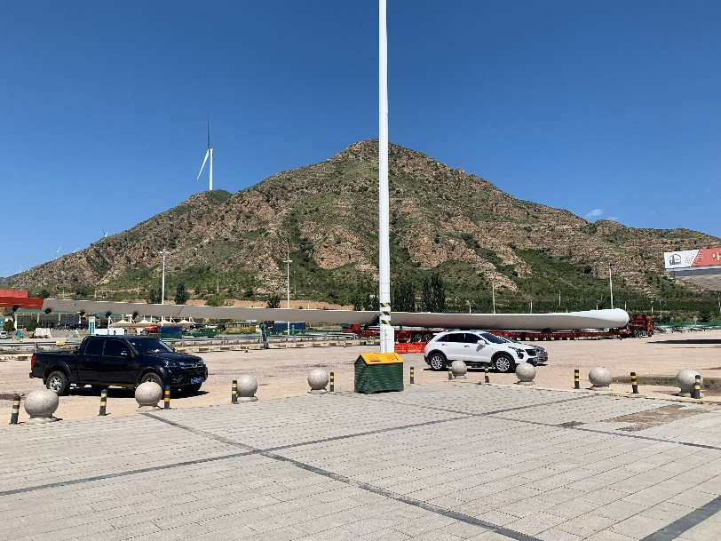

Malheureusement, j’étais au volant, et je devais vite ramener mon regard droit devant. Après tout, la tension de rouler sur un viaduc à cent mètres de haut n’avait rien à envier au choc des monts Taihang. Je n’ai pas le vertige, mais sans trop savoir pourquoi, j’avais l’impression que la voiture flottait, toute légère (à y repenser, il y avait peut-être du vent latéral !), et je devais donc redoubler de concentration. Même avec une puissance de calcul mise à rude épreuve, mon cerveau a tout de même relevé une bizarrerie : si nous montions dans les Taihang depuis la plaine de Chine du Nord, du sud-est vers le nord-ouest, les montagnes auraient dû se trouver à gauche de la route. Pourquoi étaient-elles donc à droite ? En consultant la carte après coup, j’ai appris qu’à ce moment-là, nous avions en fait déjà traversé les Taihang par cette série de tunnels, et que nous nous trouvions dans le grand canyon de la Sanggan, qui touche le piémont nord de la chaîne. La carte montrait qu’ici, les monts Taihang suivent justement un axe nord-est–sud-ouest. Voilà qui expliquait tout. Et le bassin de la Sanggan où nous étions rejoint Datong à l’ouest et mène, à l’est, au bassin de Zhangjiakou–Xuanhua, au sud duquel se trouvent Badaling et Juyongguan. Après avoir roulé encore un moment, les panneaux l’ont confirmé : nous étions bien dans le grand canyon de la Sanggan, et nous allions bientôt passer par Yuxian.

### Échos de l’histoire

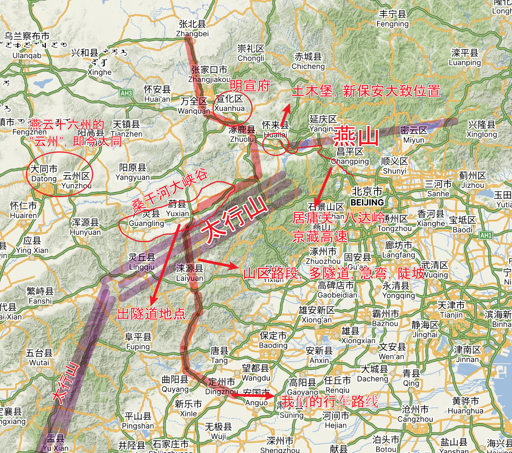

Arrivés ici, les amateurs d’histoire des Ming sentent peut-être leur ADN frémir : pourquoi ces noms de lieux sont-ils si familiers ? N’est-ce pas là qu’a eu lieu la crise de Tumu ? Eh oui. Ce Yuxian-là, c’est le pays natal de Wang Zhen, le grand eunuque tout-puissant de l’ère Zhengtong des Ming. C’est lui qui, simplement parce qu’il ne voulait pas que l’on abîme les champs de blé du coin, a ordonné à l’armée des Ming de faire un détour vers le nord-est depuis Datong, par Xuanfu, pour rentrer par Juyongguan, ce qui a fini par provoquer la défaite en rase campagne et la capture de l’empereur Yingzong. En comparant les cartes par la suite, j’ai appris que Xuanfu correspond en fait à l’actuel district de Xuanhua, à Zhangjiakou, lui aussi sur notre route. Autrement dit, notre virée refaisait en réalité une partie de la marche de l’armée des Ming à l’époque. À cette pensée, allongé à plat ventre sur le lit de la maison familiale de Dingzhou, tard dans la nuit, à scruter la carte numérique, j’ai senti un frisson inexplicable me parcourir. C’était comme si, sous ce ciel nocturne paisible, le passé et le présent se superposaient en silence.

Bientôt, j’ai fait une autre découverte. Dans le bassin entre Zhangjiakou et Badaling se trouve le district de Huailai, et dans ce district, un « bourg de Tumu » : ce doit donc être le petit coin de paradis de Yingzong. Et ce n’est pas tout. En déplaçant le regard au nord-ouest de Huailai, on tombe sur le « bourg de Xinbao’an ». N’est-ce pas là que la 35e armée de Fu Zuoyi a été encerclée et anéantie pendant la campagne de Pingjin… Haha. C’est un peu de l’humour noir, mais je n’ai pas pu m’empêcher d’éclater de rire. Visiblement, ce bassin qui relie Pékin à Zhangjiakou est un lieu stratégique depuis la nuit des temps.

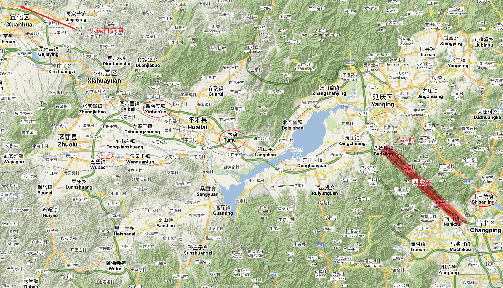

Mon regard a ensuite glissé vers Juyongguan et Badaling. L’autoroute Pékin–Tibet s’échappe, solitaire, de Pékin par l’étroite vallée qui sépare Juyongguan de Badaling. Cette porte de la capitale, que les dynasties d’autrefois gardaient avec des troupes nombreuses, n’est donc plus une barrière infranchissable, mais une voie ouverte à tous ; il y a de quoi rester songeur. Cela m’a aussi rappelé notre premier voyage à Pékin, à ma mère et moi, quand j’étais petit. L’agence de voyages avait promis de nous emmener à la Grande Muraille de Badaling, mais au bout du compte, elle ne nous a accordé que quarante minutes sur la section de Juyongguan. Plus déchirant encore : nous n’avions que quelques minutes de retard, ma mère et moi, et le car est parti sans nous. Furieux, nous sommes tombés sur un chauffeur de taxi ; nous lui avons donné 300 yuans pour qu’il nous emmène à Badaling, aux tombeaux des Ming et ailleurs, des endroits qui ne figuraient même pas au programme. Plus tard, sans doute quand est venue l’heure de l’arrêt shopping, l’agence s’est enfin souvenue de nous et nous a même appelés pour qu’on revienne. Nous avons évidemment refusé. Bye bye, messieurs-dames !

Mais revenons à nos moutons. Nous avons suivi le bassin en direction de Zhangjiakou et de Zhangbei, et sur le dernier tronçon, nous nous sommes soudain retrouvés dans un bouchon, coincés pendant à peu près une heure. C’était encore moi qui conduisais, et à force d’avancer par à-coups, j’ai commencé à avoir la tête lourde et embrumée. C’est alors que ma grand-mère, qui avait dormi à poings fermés tout le trajet, s’est réveillée au pire moment et s’est mise à demander d’une voix chevrotante : « On est où, là ? Je veux rentrer ! » Sa voix était pleine de détresse et d’angoisse, et nous avions beau lui expliquer, elle continuait à questionner, à réclamer, à s’agiter, encore et encore. Ces ondes négatives n’ont pas tardé à déteindre sur moi, et mon mal de tête n’a fait qu’empirer, chose qui ne m’était jamais arrivée auparavant. Pour un conducteur, un bouchon, c’est déjà exaspérant en soi ; ajoutez-y tout ce qui se passait avec ma grand-mère, et j’étais encore plus à cran. Une fois sortis de l’autoroute, nous avons trouvé un petit restaurant du coin. Pendant que je me garais, je ne sais plus ce qui s’est passé (peut-être que mon mal de tête avait encore empiré ?), mais ma patience a fini par atteindre ses limites. J’avais terriblement besoin d’une soupape, mais il n’y avait personne sur qui me défouler. Ma mère organisait tout le voyage à elle seule ; elle s’était donné tant de mal. Ma grand-mère n’avait déjà plus toute sa tête ; qu’y pouvait-on ? Personne n’était en tort, mais l’atmosphère était tout simplement étouffante. Sur le moment, j’ai quand même fini par me raisonner : il fallait que je seconde ma mère. Alors, dans un accès de colère, j’ai… continué à prendre sur moi. C’était vraiment pénible. Pendant le repas, ma grand-mère a fait des siennes elle aussi, refusant de manger, ce qui nous a tous mis mal à l’aise. J’ai continué à prendre sur moi. Après le repas, nous avons pris la route de la maison d’hôtes réservée à l’avance. La route était difficile : des virages sans arrêt, une seule voie dans chaque sens, et parfois les arbres qui la bordaient bouchaient la vue. Si bien que je devais aborder chaque virage avec une prudence redoublée, ce qui m’épuisait. J’avais l’impression que mon crâne allait éclater ; j’étais presque à bout. Heureusement, une fois la ville derrière nous, nous sommes peu à peu entrés dans la vaste prairie, et le paysage alentour avait de quoi vous dilater le cœur. Malgré tout, mon mal de tête restait terrible. À peine arrivé à la maison d’hôtes, je me suis effondré sur le canapé et endormi d’un coup ; juste avant de sombrer, j’ai vaguement entendu mon oncle aîné dire : « Laissez-le dormir un peu… »

Un peu plus d’une heure plus tard, je me suis réveillé ; mon mal de tête avait en grande partie disparu. J’ai appris que ma grand-mère, épuisée, s’était elle aussi profondément endormie. Mon oncle aîné a proposé de rester à la maison d’hôtes pour veiller sur elle, pendant que ma mère, mon plus jeune oncle et moi irions visiter Yehuling, tout près. Yehuling, la « crête du Renard sauvage », est une colline au milieu de l’immense prairie. Au musée d’histoire, à mi-pente, j’ai appris que c’est ici même qu’a eu lieu la bataille de Yehuling, la bataille décisive livrée par Gengis Khan avant d’entrer dans les Plaines centrales. Incroyable : ce parc aujourd’hui envahi de touristes (bon, pas tant que ça, en fait) est l’endroit même où, il y a des siècles, le gros de l’armée de campagne des Jin a été anéanti. Du sommet principal de Yehuling, le regard embrassait la prairie ondulante sur une bonne dizaine de kilomètres à la ronde. Quelques routes la sillonnaient, où des voitures grosses comme des graines de sésame apparaissaient et disparaissaient sur des pâturages qui semblaient ne jamais finir. J’ai essayé d’imaginer les généraux d’autrefois contemplant d’ici leurs armées en pleine bataille, mais je n’arrivais vraiment pas à me le figurer. Peut-être en partie à cause de ces hautes éoliennes blanches plantées un peu partout dans la prairie, qui me sortaient de la scène. Partout où portait le regard, des rangées et des rangées d’éoliennes insufflaient à la prairie sauvage un peu de la vitalité du monde moderne. Aujourd’hui, les environs de Yehuling sont devenus une terre où les gens vivent et travaillent.

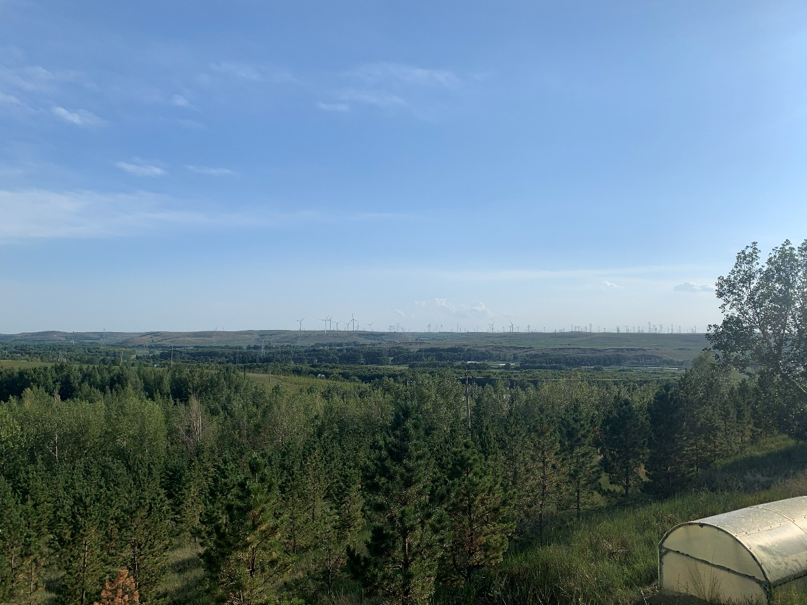

Je dois dire que l’âpreté des Taihang et l’immensité de la prairie m’ont bien plus ébranlé, et ont résonné en moi bien plus longtemps, que les monts verdoyants du Yunnan, du Guangxi et du Guizhou que j’ai parcourus, ou que les eaux limpides et les montagnes émeraude de Zhangjiajie, de Jiuzhaigou et de Banff qui font saliver d’envie dans les publications WeChat de mes amis. Combien de dynasties ces confins de Yan et de Yun ont-ils vu s’élever puis s’effondrer ? Combien de cavaliers des steppes, avides de piller la terre chinoise, les majestueux Taihang ont-ils arrêtés ? Et pourtant, en cet instant, les montagnes séculaires se taisent et se contentent de baigner tranquillement dans la lumière d’un matin d’été. On dirait un vieux soldat qui a déposé les armes et quitté le champ de bataille pour retourner à ses champs, assis au soleil à l’entrée du village, gardant au fond du cœur tous les tumultes des anciens champs de bataille et savourant, sourire aux lèvres, une paix chèrement acquise. L’ancienne marche frontière, ces Seize Préfectures de Yan et de Yun que l’empereur Taizong des Song a convoitées toute une vie de guerres sans jamais les obtenir, appartiennent enfin à une Chine unie.

Le lendemain, ma grand-mère avait retrouvé un peu d’énergie, et nous avons visité le site de la Route céleste des prairies ; tout le monde (ma grand-mère comprise) s’en est donné à cœur joie.

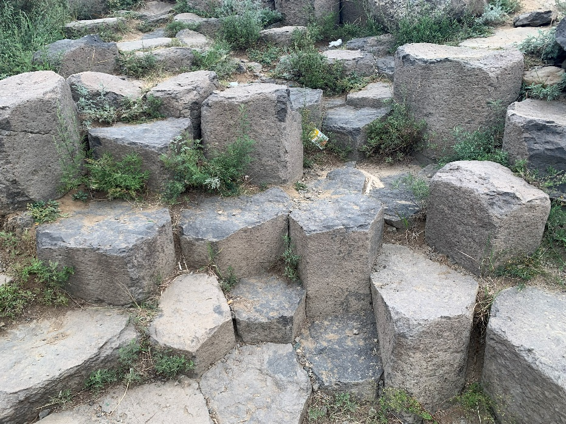

### Retour à Dingzhou

Au retour, c’est ma mère qui a pris le volant en premier. À l’heure du déjeuner, nous avons acheté quelques petits pains vapeur à la va-vite sur une aire de service perdue au milieu de nulle part, puis nous avons repris la route. Mais peu après, ma mère a dit qu’elle avait trop sommeil pour continuer, et nous avons échangé à l’aire suivante. Très vite, un silence complet s’est installé dans la voiture : tout le monde dormait, sauf moi. Ma grand-mère et mes deux oncles à l’arrière, cela va sans dire, mais même ma mère, sur le siège passager, avait sombré dans un profond sommeil. Elle qui débordait toujours d’énergie et ne s’avouait jamais vaincue était, elle aussi, épuisée à ce point. Justement, la voiture rentrait de nouveau dans les monts Taihang : une longue descente à grande vitesse, rien que des tunnels et des virages serrés. Même si la vitesse maximale était descendue à 80, j’avais encore l’impression d’aller un peu vite, et je sentais la force centrifuge dans les virages. Mais toutes les voitures autour roulaient à cette allure, impossible de ralentir davantage. Dans le plus long tunnel, je me suis rendu compte que si je ne freinais pas, la voiture continuait à prendre doucement de la vitesse. La pente était donc aussi raide que ça ??? J’ai dû conduire avec 150 % de ma concentration : surtout ne pas avoir d’accident dans la montagne, la vie de toute une voiture de proches endormis était entre mes mains. Un sentiment de responsabilité m’a submergé d’un coup. Le relais qui était autrefois entre les mains de ma mère m’avait-il donc été transmis ? Et c’est ainsi que, dans un silence de mort, seul et tendu à l’extrême, j’ai conduit toute cette heure et demie de descente à travers les Taihang, avec pour seule compagnie les vieilles chansons qui défilaient sur l’autoradio. En arrivant au mont Baishi, tout le monde s’est réveillé peu à peu, et ma grand-mère s’est mise à demander sans arrêt quand nous serions à la maison. À ce moment-là, il ne me restait au cœur que soulagement et réconfort (et puis, j’étais mort à l’intérieur ()).

Le soir, ma mère et moi avons parlé dans notre chambre de l’état de ma grand-mère. Je n’aurais jamais imaginé que la grand-mère qui, quatre ans plus tôt, nous racontait encore avec tant d’entrain ses histoires sur les « diables japonais » de la guerre en serait arrivée là. Plus je parlais, plus je m’emportais. Je me suis dit que peut-être, dans bien des années, ma mère deviendrait comme ça, elle aussi ; une scène que je n’osais vraiment pas imaginer. Mais tôt ou tard, il faudra bien que j’affronte la mort seul, non ? Ne dit-on pas que nos parents sont le dernier rempart entre nous et la mort ? Mais quand ce jour viendra pour de bon, comment ce sera… Je suis en master, pas encore diplômé (je ne l’étais pas à l’époque ; maintenant, si), et l’avenir est incertain, lui aussi. Je ne sais même pas si je trouverai la bonne personne avec qui parcourir la seconde moitié de ma vie. Peut-être que je vais vraiment mourir seul. Tout seul. À cette pensée, les émotions accumulées depuis trop longtemps ont fini par exploser. Tous les tracas et toutes les blessures de ces quatre années seul à l’étranger me sont remontés d’un coup. La pression et les déboires en tout genre, dans les études, dans la vie quotidienne, dans les relations, l’échec de mon premier amour, et j’en passe : pendant toutes ces années, j’avais encaissé chaque peine en silence, seul, sans jamais pleurer à chaudes larmes. Je me souviens que le jour de la rupture, je m’étais contenté de marcher en laissant les larmes couler doucement sur mes joues, m’efforçant encore de contenir la violence de mes émotions. Au fond, je suis quelqu’un de très sensible, qui a tendance à trop réfléchir ; ce n’est que parce que je vivais seul, loin de chez moi, que je m’efforçais de porter le masque de la raison. Mais dans mon cœur, je suis sans doute toujours resté ce petit écolier peureux. Et pourtant, ce même petit écolier peureux, au collège, au lycée puis à l’université, ne s’est jamais confié à personne et a traversé seul tous les moments difficiles. Quand j’y repense. Lorsque mes parents se disputaient, chacun venait souvent s’épancher auprès de moi. Mais moi, quand j’avais des soucis, vers qui me tournais-je ? Je ne voulais pas déranger mes amis. Je ne voulais pas montrer ma part fragile aux autres. Mon père, lui, ne savait que répéter qu’un homme, ça ne pleure pas. Je ne me suis tourné vers personne. Mais cette nuit-là, je n’en pouvais vraiment plus. Devant ma mère, chose rare, j’ai éclaté en sanglots. Ma respiration était si haletante que j’ai cru que j’allais vraiment étouffer. Les larmes déferlaient par vagues, et ce n’était toujours pas fini. Au bout de ce qui m’a semblé vingt minutes, tout est enfin retombé dans le silence. Il me semble me souvenir que ma mère a d’abord dit « Ça va aller, ça va aller », « Ce jour-là finit par arriver pour tout le monde », mais ces tentatives de consolation sont restées vaines ; puis elle a dit : si tu as besoin de pleurer, pleure. Et j’ai pleuré de plus belle.

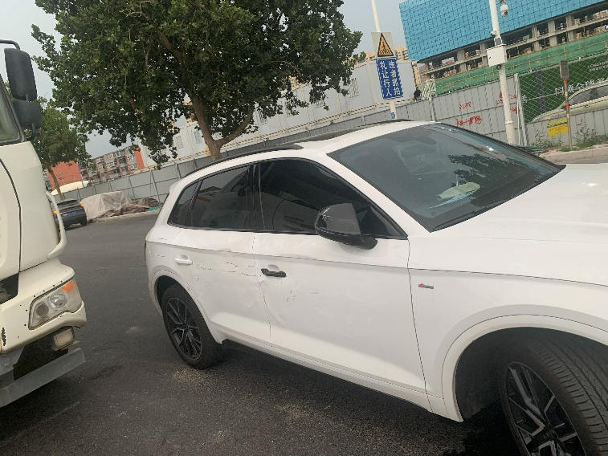

Par la suite, nous sommes encore allés à Baoding, à Xibaipo et ailleurs, mais ceci est une autre histoire.

## Jinan, la cité des sources
Au retour, ma mère et moi nous sommes de nouveau relayés au volant. Le premier après-midi, nous sommes arrivés à Jinan et sommes allés nous promener au lac Daming. En apercevant sur le site un panneau « Poste de commandement provisoire de la garnison nationaliste pendant la bataille de Jinan », j’ai de nouveau ri, pas très charitablement. Le soir, nous avons goûté au poisson au vinaigre du lac Daming (bien, bien meilleur que le tristement célèbre poisson au vinaigre du lac de l’Ouest, à Hangzhou), au porc braisé à la mode de Jinan et à d’autres spécialités ; repus, nous avons longuement marché dans le parc qui longe les douves de la cité des sources. À Jinan, l’air humide de la nuit gardait admirablement la chaleur du soleil de la journée : on transpirait un peu sans pour autant étouffer, et de temps en temps une petite brise passait, plutôt rafraîchissante. Nous n’avions aucune destination en tête ; nous flânions simplement d’une source à l’autre. Sur la place publique, les dames du quartier enchaînaient leurs danses de groupe dans une joyeuse animation, et il y avait aussi, je crois, des feux d’artifice (ou alors des points lumineux dans le ciel ? je ne m’en souviens plus très bien). De temps à autre, nous remplissions une bouteille d’eau de source à une fontaine publique pour la boire d’un trait ; la fraîcheur descendait de la gorge jusqu’à l’estomac. Quel bonheur ! Ce fut, ces dernières années, le seul moment où j’ai vraiment laissé de côté tout le fatras qui m’encombrait l’esprit et relâché mes nerfs à vif.

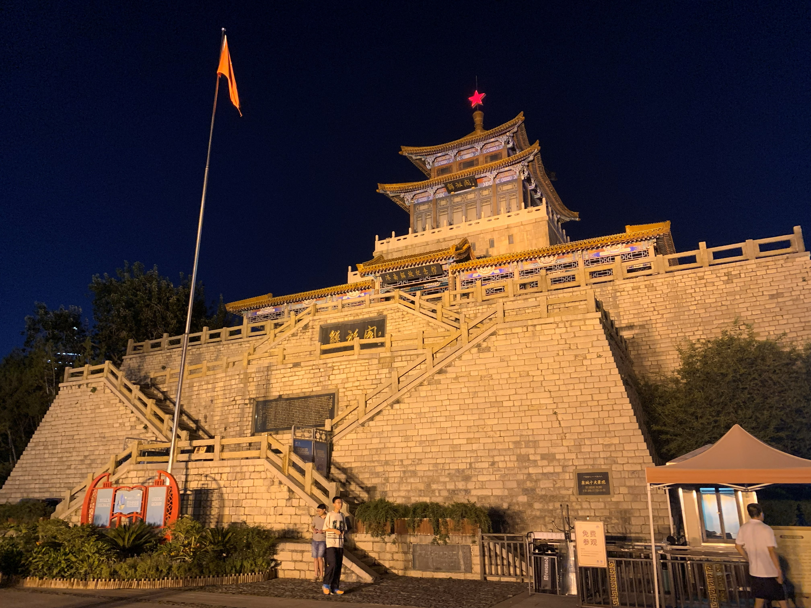 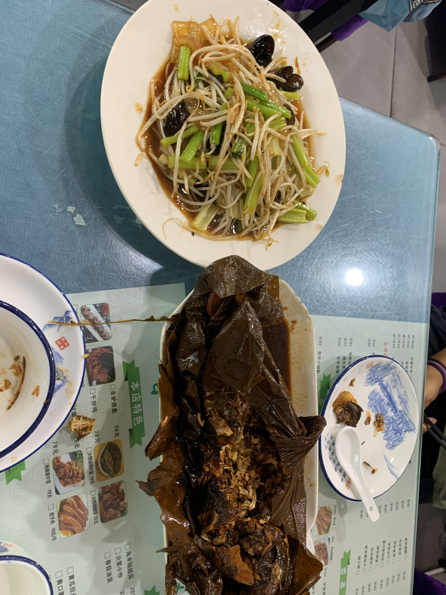

Le lendemain, nous avons repris la route. Du côté de Huainan, nous avons essuyé des pluies torrentielles apportées par les restes d’un typhon remontant vers le nord. Sous les trombes d’eau, les essuie-glaces ne servaient absolument à rien ; devant nous, tout n’était qu’un flou, et on ne distinguait que le rouge des feux arrière et le jaune des feux de détresse de la voiture de devant. Nous avons ralenti à 40–50 km/h, et il nous a fallu environ une demi-heure pour sortir de la zone de pluie. Ce soir-là, notre voyage a enfin pris fin.

Voilà. Ce que je voulais raconter. S’arrête ici.
