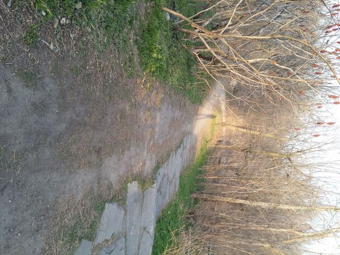
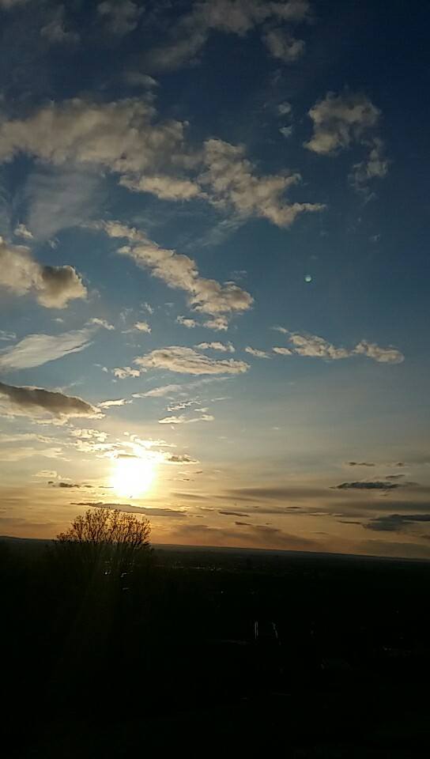

May in Montreal: warm one moment, cold the next. Spring on the North American continent has a character all its own. It has none of the muggy “south-wind days” of Guangdong and Guangxi, the clammy chill of Jiangnan, or the dry heat of northern China; none of the breakneck warming of Siberia and Central Asia that leaves you in a sweat; and none of the cool, mild mists that shroud Western and Central Europe, born of the warm, moist air that sweeps in unimpeded from the Atlantic. The moment I stepped out the door, a chill slipped in under my collar. I seemed to see, hundreds of kilometers away, the vast, hazy white ice of Hudson Bay, and to hear the north wind still howling, refusing to give up. Down jacket, padded pants—compared with what I wore in the dead of winter a few months ago, my outfit was short just one pair of long johns.

In the summer half of the year, the sun in the Northern Hemisphere rises in the northeast and sets in the northwest. Here at forty-five degrees north, around six in the evening, the sun was still high in the sky. A few dozen meters on, the clouds parted and the mist cleared, and warm, expansive sunlight spilled over me, driving off the cold; then another bank of dark cloud swept past, the wind whipped up the grit, and I couldn’t help pulling my neck back down into my collar. Early spring at high latitudes is a symphony scored for winter and summer alone: the ardent summer sun shines into an enormous block of ice, which can only melt at a tepid, half-hearted pace, while the temperature hovers forever around freezing.

After climbing a short slope I reached the foot of the mountain, and the icy feeling slowly began to recede. On Édouard-Montpetit, a few bicycles came “whooshing” past—the mountain-biking tribe, long thought extinct, was out and about again now that the snow was melting. The trees on Mount Royal had yet to bud, but the grass was already pushing up new green, and in the thickets you could glimpse tender young shoots; even the Virginia creeper clinging to a concrete statue was no exception—up close, you could see its pale purple leaf buds, one after another, poised to burst. The mountain’s little creatures weren’t about to be outdone, either: red and yellow birds with pretty (perky) tails flitted freely about the deserted campus, their twittering chatter replacing the whistling wind and the Québécois patter in my ears; a groundhog (?), a creature I had never seen before, poked its head out of a burrow by the path to soak up some sun; and the squirrels, brown and black, go without saying: they never hibernate.

On the avenue that runs alongside Notre-Dame-des-Neiges Cemetery toward the trailhead, there were more people; by the time I had climbed from the trailhead up to the green lawn, there were already more than ten Quebeckers in sight. Some were university students, some were couples (dating or married), and there were families and older folks too; they sat right on the grass, or on the nearby benches facing the city in the distance—quite the lively scene. I still remember climbing up here with czq during a blizzard last winter, when the snow came up to mid-thigh; now, instead, there was the lovely sight of grass that had lain dormant for months, swaying in the breeze under the slanting, cream-colored light.

By my count, this was the fourth time I’d come here for a walk. The previous times I’d had company; this time it was just me and my shadow, so I especially treasured this chance to walk alone. Though bursts of laughter kept breaking out around me, and my keen ears couldn’t help catching the sweet nothings murmured by the couples on the benches, I’ll just admit it outright—I was lonely. But is loneliness necessarily a bad thing? Take the word *alone*: it began life as *all one*—a gentleman whole unto himself, munching his popcorn as he watches the show and laughs. And at the heart of *lonely* sits *one*, which could just as well mean independent, or one of a kind. In any case, I’ve always believed that in the end everyone has to face their own solitary self, and learning to do so a little early is no bad thing. With these thoughts, I kept silent, paid no attention to the commotion around me, and simply followed the winding mountain path. *Contempler.*

When I reached the second terrace, I saw a young woman gazing, lost in thought, at the sun sinking in the west. All was quiet around us; there were only the two of us left. I came to a silent halt behind her and looked around: the trees on the second terrace seemed to have grown a little taller since last year—tall enough, now, to block the terrace’s sweeping view; other than that, nothing new. Then the young woman took a step toward the cliff edge and simply sat down, hugging her knees, on the slope at the terrace’s rim, letting the shrubs fill her field of view. She tilted her head, her gaze seemingly fixed on the setting sun among the sparse shadows of the branches. It was already past seven in the evening, and the light around us was beginning to shift from bright yellow to orange-red. The sunlight, slipping through the tangled branches, fell on her long hair, so that you couldn’t make out its true color—perhaps she was *rousse*, or perhaps that translucent glow came only from the breeze tousling her hair and the red light washing through it.

She was alone. Alone, like me. She seemed oblivious to everything around her—I say this because a couple who had been talking loudly the whole time also came up onto the second terrace, and she didn’t even notice them arrive… How lovely. …For some reason, I felt comforted, even though I’d been telling myself that loneliness was no big deal—how ridiculous. I stood there a while, then left without a word. What a pitiful and hateful thing the self is, for it can never hold its ground and stay unswayed by others.

With no trees in the way, the third terrace is the perfect spot to watch the sunset. When I got there, plenty of Quebeckers had already gathered. I picked out a warm rock, sat down, and waited quietly. In the middle of the terrace, a young guy was stretching on a yoga mat as if no one else were there; not far from him, a few people were chatting in English; on the rock next to mine, a pair of girlfriends were talking in French; and at the very front of the terrace was that couple. Yes. What our foreign friends are really good at is forgetting themselves. They do whatever they feel like, without the slightest concern for what others think. I don’t seem able to… Though, come to think of it, that only works if your own thinking is entirely correct; otherwise it veers into extremism… But who can guarantee that their own thinking is correct?… Correct judgment requires correct knowledge, and that seems to set us on the perilous road to becoming a polymath. I’ve recently realized that reason is not as simple as a slogan you shout; for reason cannot make a correct judgment unless it knows the true consequences of every action. What, so being rational means turning yourself into a world simulator? As if the rational person could become omniscient and foresee the future—such ultimate rationality would be downright freakish! And at the same time, what “correct” even means deserves some thought… Correctness truly depends on one’s own values (subjective correctness); so what on earth is objective correctness?! If you understood all this, you could become rational, completely master your desires, and make them serve your values………… Ahem. I set out to write about the sunset, and here I am rambling about all this again. Honestly.

And how could I ever describe the beauty of that sunset? The eye is the best camera. While the guy beside me, who had set up a professional camera, was firing away madly at the shutter, I was recording this exquisite scene with my eyes. Literature, mathematics, physics—these are merely ways of describing the world; so is our vision, and so is a camera. For a subject like a sun setting blood-red, mathematics and physics seem stiff, a camera seems to falsify, and literature adds room for imagination; only the eye does it best. Or rather: the one true way is to blend it with everything around it—sounds, touch, heartbeat, body warmth, smells—into a single memory, and keep it forever in your heart.

The sun disappeared, leaving only the photographer and me. His shutter was still clicking away as I left, rubbing my frozen hands. Night was deepening; it was already eight thirty, and I still hadn’t eaten. Time to go back to life.
