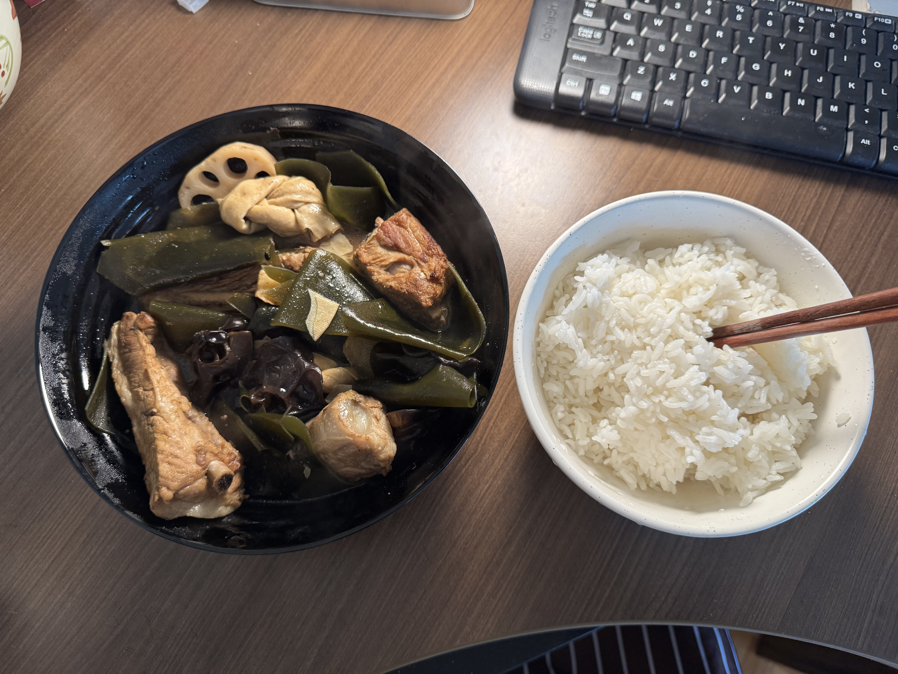

## Ingredients

### Main

* Pork ribs, as many as you like

### For blanching

* Scallion pieces, ginger slices
* Shaoxing cooking wine (for the blanching water)

### For caramelizing sugar for color / frying the aromatics

* Cooking oil
* White sugar, 2–3 spoonfuls (your usual amount)
* Scallions, ginger
* Star anise, cassia bark (and Sichuan pepper too, if you like)

### For seasoning / braising

* Shaoxing cooking wine (drizzled down the side of the wok once the aromatics are fragrant)
* Dark soy sauce (for color; just a little, and don’t fry it for long)
* Light soy sauce
* Salt
* Ground pepper (optional)
* Water or plain chicken stock (enough to cover the ribs)

### Optional add-ins

* Carrots / potatoes / kelp / bamboo shoots / wood ear mushrooms / tofu knots / tofu skin (dried tofu sheets), etc.

---

## Steps (the clear version)

### 1) Blanch to get rid of the gaminess

1. Put the ribs in a pot **starting from cold water**, with scallion, ginger and a splash of cooking wine.
2. Bring to a boil over high heat; scum will rise to the top. Keep it boiling for about **1–2 minutes**.
3. Turn off the heat and pour away the water and the scum.
4. **Rinse the ribs under cold water** to wash off any scum still clinging to them.
5. Lift them out and **drain/air-dry them as much as you can**, or pat the surface dry with paper towels (the sugar-caramelizing step that comes next will go much more smoothly).

### 2) Caramelize the sugar + color the ribs

1. Heat oil in the wok; once it’s hot, add **2–3 spoonfuls** of white sugar.
2. Keep stirring until the sugar melts and turns a **deep reddish brown** (that’s your caramel color).
3. Add the dried ribs—**don’t add too many at once** (one or two layers at most)—and stir-fry over medium-high heat so they get evenly coated in caramel, turn lightly golden brown, and render out a bit of fat.

### 3) Add the spices and fry until fragrant

1. Add the scallions, ginger, star anise and cassia bark (a little Sichuan pepper is welcome too).
2. Keep stir-frying for a while to bring out the aromas (pretty much no water at all during this whole stage).

### 4) Splash wine down the side of the wok + dark soy for color

1. **Drizzle the cooking wine down the side of the wok a little at a time** (in 2–3 additions); when you hear it sizzle and steam off, give everything a few stirs.
2. Add a little **dark soy sauce** for color, and **don’t fry it for too long**, or it’ll scorch.

### 5) Add stock/water, braise and season

1. Right away, add water or plain chicken stock, **enough to cover the ribs**.
2. Once it boils, season it: pepper, light soy sauce, salt (go easy on the salt for now).
3. **Taste the broth**: at this point “just slightly salty” is all you want—it will get saltier and darker once you reduce the sauce later.

### 6) Low and slow

1. Turn the heat down to low and simmer until the ribs are as tender as you like.
2. Partway through, you can **fish out the scallions and ginger** (the scallions turn to mush easily, and ginger doesn’t taste great after a long simmer).

### 7) Reduce the sauce and serve

1. Once the meat is tender, turn the heat up high to reduce the sauce until it’s as thick and as salty as you like, then dish it up.
